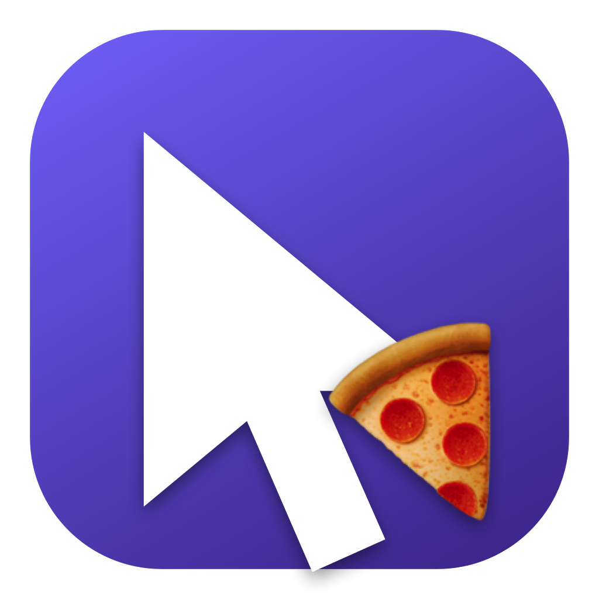

# Pointy 🍕

Your Mac's cursor has been the same arrow since 1984. That is a very long time to be an arrow.

**Pointy** is a tiny Mac app that swaps your mouse pointer for literally any image — a pizza slice, a mushroom, a unicorn, your dog, whatever. Click a tile, and boom: your cursor is a pizza. Everywhere. In every app. Your coworkers will have questions.

<p align="center"></p>

## What you get

- 🍕 🍌 🦄 🔥 👾 🍩 ⚡️ 🌵 🎯 🐝 🍄 🪄 — 12 built-in emoji cursors, zero effort
- **Bring your own images** — drop in any picture (transparent PNGs look crispest)
- A **"Click point"** picker: click with the top-left tip like a civilized arrow user, or with the center like a chaos gremlin
- **Reset to Default** — one click, for when someone important walks by
- The cursor stays swapped even after you quit the app. It goes back to normal when you restart your Mac — just open Pointy again and it re-applies your last pick

## Install

### Option 1: the normal way

You'll need the Xcode Command Line Tools. Not sure if you have them? Run `xcode-select --install` — it will either install them or tell you to go away because you already do.

```sh
git clone https://github.com/pratikaman/Pointy.git
cd Pointy
./build.sh --install
open ~/Applications/Pointy.app
```

### Option 2: make a robot do it 🤖

Got an AI coding agent in your terminal — Claude Code, Codex, Gemini CLI, whatever? You don't need to read instructions ever again. Just paste this into your agent:

> Install the app from https://github.com/pratikaman/Pointy — clone it, run ./build.sh --install, then open ~/Applications/Pointy.app. If the build fails because Xcode Command Line Tools are missing, help me install those first.

Or as a one-liner, straight from your shell:

```sh
# Claude Code
claude "Install the app from https://github.com/pratikaman/Pointy: clone it, run ./build.sh --install, then open ~/Applications/Pointy.app"

# Codex
codex "Install the app from https://github.com/pratikaman/Pointy: clone it, run ./build.sh --install, then open ~/Applications/Pointy.app"

# Gemini CLI
gemini -p "Install the app from https://github.com/pratikaman/Pointy: clone it, run ./build.sh --install, then open ~/Applications/Pointy.app"
```

Any agent that can run shell commands will figure it out. The build takes a few seconds and doesn't need `sudo`.

## How it works (the fun part)

macOS keeps a secret internal table that says "when the cursor should be an arrow, draw *this* picture." Pointy walks up to the WindowServer and politely overwrites that picture with your pizza, using the same private APIs as the legendary [Mousecape](https://github.com/alexzielenski/Mousecape) (`CGSRegisterCursorWithImages` and friends).

**Plot twist:** on macOS 26+ this stopped working, because Apple quietly gave the arrow a new secret name — `com.apple.coregraphics.ArrowS` — and writing to the old name does nothing. Silently. *With a success return code.* Pointy enumerates all the system cursor names and overwrites every arrow alias it finds (the fix pioneered by the [Mousecape-TahoeSupport fork](https://github.com/AdamWawrzynkowskiGF/Mousecape-TahoeSupport)), so it works on modern macOS.

**Bonus fact from the debugging trenches:** `screencapture -C` does not capture your real cursor — it pastes a stock arrow on top of the screenshot. So if you try to screenshot your beautiful pizza cursor, macOS will gaslight you. The pizza is real. The screenshot is lying.

## FAQ

**Is this safe?**
Yes. No `sudo`, no system files touched, no SIP shenanigans. It asks the WindowServer nicely, and the WindowServer can always be reset — click *Reset to Default*, or restart your Mac.

**Why is my text cursor still the boring I-beam?**
v1 only replaces the arrow. The I-beam, pointing hand, etc. are a v2 problem (the same trick works — `IBeamS` is sitting right there at cursor id 101).

**Clicking a cursor does nothing and there's an orange banner?**
If you use a custom pointer color or enlarged pointer size (System Settings → Accessibility → Display), macOS can override custom cursors. The banner in the app takes you right to the setting.

**Will this break someday?**
It's built on private APIs, so… maybe! It already broke once (macOS 26) and the community fixed it in a week. Such is the circle of life.

## Build it yourself

No Xcode project, no dependencies — just `swiftc` over three Swift files:

```sh
./build.sh            # builds build/Pointy.app
./build.sh --install  # also copies it to ~/Applications
```

`scripts/make_icon.swift` regenerates the app icon (yes, the icon is also made of code).

## Credits

- [Mousecape](https://github.com/alexzielenski/Mousecape) by Alex Zielenski — the OG cursor swapper
- [Mousecape-TahoeSupport](https://github.com/AdamWawrzynkowskiGF/Mousecape-TahoeSupport) by Adam Wawrzynkowski — the macOS 26 `ArrowS` discovery
